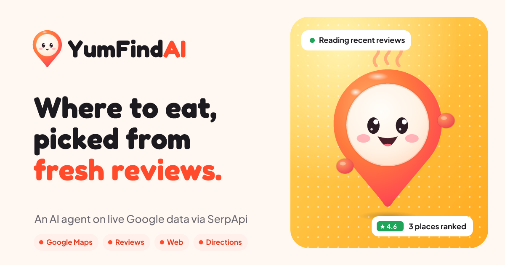

<p align="center"></p>

<h1 align="center">YumFindAI</h1>

<p align="center"><b>Not just what's nearby: an AI agent that matches food to <i>your</i> taste, using what people said this month.</b></p>

<p align="center">
SerpApi India Hackathon 2026 · Track: <b>Travel &amp; Local Discovery</b> · built as an <b>AI agent</b> on live Google data
</p>

---

Google Maps can list every restaurant near you. YumFindAI answers a different question: **which of them fits you?** Tell it where you are, what you're craving and how you like it (mild or spicy, veg, family-friendly). Instead of showing every place that matches a keyword, an agent decides for itself which Google data to pull through SerpApi. It searches Google Maps around you and reads the newest reviews of the strongest candidates. When the evidence is thin it widens the radius or tries the local name of the dish, and it can cross-check food blogs on the web or check the drive time. Every step appears live on the map while it works, and the final ranking only includes places whose reviews it actually read.

Two things no map app does:

- **Taste Twins.** A 4.5★ average mixes everyone's opinion. YumFindAI finds the reviewers of each place **who eat like you**: it reads their wider Google review history, scores how close their taste is to yours, and shows what *they* said. Places your taste twins loved move up the list.
- **Menu & prices.** Most restaurants post photos of their menu on Google Maps, but nobody wants to zoom through 20 photos. YumFindAI reads them into a searchable price list, puts the dishes matching your craving on top, and lets the chat answer *"how much is a biryani here?"*
- **Snap a dish.** Saw something tasty on Instagram? Upload or take a photo. Google Lens names the dish and YumFindAI finds who makes it best near you, your way.

Then you can **chat about the results**: *"Which one is least spicy?"* … *"Does it have parking?"* … *"What did my taste twins say?"* It remembers the conversation and your taste.

## Contents

- [What it does](#what-it-does)
- [How the agent works](#how-the-agent-works)
- [SerpApi usage](#serpapi-usage)
- [Taste Twins](#taste-twins)
- [Menu & prices](#menu--prices)
- [Snap a dish](#snap-a-dish)
- [Chat, memory and caching](#chat-memory-and-caching)
- [Keeping tokens and credits down](#keeping-tokens-and-credits-down)
- [Meet the mascot](#meet-the-mascot)
- [Stack](#stack)
- [Run it locally](#run-it-locally)
- [API](#api)
- [Project layout](#project-layout)
- [What was tested](#what-was-tested)
- [Known limits](#known-limits)
- [AI tools used in building this](#ai-tools-used-in-building-this)

## What it does

| A maps app | YumFindAI |
| --- | --- |
| Shows every place matching a keyword | Ranks a short list from **evidence in reviews from the last 3 months** |
| Rating is a number | A verdict says *what reviewers said about your dish*, and says plainly when they didn't mention it |
| One query, one list | An **agent loop**: search → read → judge → widen, re-query or cross-check → finish |
| Opaque | A **live trace** of every SerpApi call the agent chose, plus a "How YumFindAI decided" log with the run's cost |
| Opening hours you have to read | **"Closes in 40 min · ~12 min away, cutting it close"**: Maps hours combined with drive time |
| Reviews you have to skim | **Dishes reviewers praise** as chips, checked against the reviews the agent read |
| Everyone's rating counts the same | **Taste Twins**: reviewers whose own review history matches your taste, and what they said here |
| Menu photos you have to zoom through | **Menu & prices**: menu photos read into a searchable price list |
| Search by typing | **Snap a dish**: a photo becomes a search (Google Lens) |
| Follow-ups start over | **Ask about these** opens a chat that remembers the conversation and your taste across searches |

The flow on screen:

1. **Where are you?** *Locate me* (or drop a pin). YumFindAI shows the place name, for example "You're in Kozhikode".
2. **What are you craving?** Type a dish and how you like it, tap a category, use the mic, or **snap a photo** of a dish.
3. **Radius and preferences.** Choose from 1–10 km, veg, spicy, family, quick bite, parking, outdoor seating or a pure veg kitchen.
4. **The agent works live.** Candidate pins drop on the map while each SerpApi call appears with the reason it was made, ending with **"Finding reviewers who eat like you"**.
5. **Ranked cards.** Each card shows a rating, a review verdict, praised dishes, **"♥ 2 taste twins loved it"**, positive and negative review counts, and whether the place will be open when you arrive.
6. **Open a place.** You get your taste twins and what they said, the **menu with prices**, the full review report grouped by tone, the exact drive time, and the route drawn on the map.
7. **Ask about these.** Chat with the agent about the results.

## How the agent works

```
craving + location + radius + preferences + remembered taste
        │
        ▼
 ┌─────────────────────────── Gemini (function calling) ───────────────────────────┐
 │ picks the next tool, writes a one-line "why" the user sees, at most 8 turns      │
 │                                                                                  │
 │   search_places   → SerpApi google_maps                (≤ 3 per run)              │
 │   read_reviews    → SerpApi google_maps_reviews        (several places at once)   │
 │   web_search      → SerpApi google                     (blogs, "best X in Y")     │
 │   get_directions  → SerpApi google_maps_directions     (drive time)               │
 │   finish          → ranked places, verdicts, review-support score, praised dishes │
 └──────────────────────────────────────────────────────────────────────────────────┘
        │
        ▼
 Taste Twins → SerpApi google_maps_contributor_reviews (reviewer histories)
             → Gemini scores each reviewer's taste against yours → twins re-rank the list
        │  events stream to the browser as newline-delimited JSON
        ▼
 map: pins drop as candidates are found → live step list → ranked cards → chat
```

Guard rails:

- **Budget.** 12 SerpApi calls per search and 4 per chat message. When it runs out, tools say so and the agent must finish with what it has.
- **No invented facts.** The agent can only rank places that came back from `search_places` and whose reviews it read. Verdicts paraphrase those reviews and must say so when the dish isn't mentioned. Praised dishes it names are dropped unless they appear in the reviews.
- **Stop rule.** At most 3 Maps searches per run. If two rounds of reviews never mention the dish, the agent finishes and says so instead of wandering.
- **Deterministic fallback.** If Gemini is unavailable, the server runs the plan itself (search, then read reviews for the top five, then rank by rating and distance) and labels the result as rating-only.
- **Topic gate.** Requests that aren't about food are refused before any SerpApi call.

## SerpApi usage

All SerpApi calls are made server-side in [`server/src/serp.ts`](server/src/serp.ts), with `google_domain=google.co.in`, `gl=in` and `hl=en`. The agent in [`server/src/agent.ts`](server/src/agent.ts) decides when to call each one. The key never reaches the browser.

| Engine | Used for | Notable parameters |
| --- | --- | --- |
| `google_maps` (`type=search`) | Finding open places for the craving near the user. The agent re-calls it with a wider radius or a different query when results are thin. Also returns weekly `operating_hours`, used for "open when you get there". | `lat`, `lon`, `m` (radius in metres), `nearby=true`, `open_state=now`, optional `min_rating`, `json_restrictor` to trim the payload |
| `google_maps_reviews` | The newest reviews for shortlisted places, fetched several at a time in parallel; the agent can page deeper when the dish isn't mentioned yet | `data_id` / `place_id`, `sort_by=newestFirst`, `next_page_token` (resumable); reviews older than 90 days are dropped |
| `google` (organic) | Cross-checking candidates against local food blogs and "best X in <area>" lists, or finding a dish's local name | `q`, `num=8`, `json_restrictor=organic_results[].{title,link,snippet}` |
| `google_maps_directions` | Drive time when the user cares about distance; the exact drive time and route line when a place is opened | `start_coords`, `end_coords`, `travel_mode=0` |
| `google_maps_contributor_reviews` | **Taste Twins**: what a reviewer of a ranked place has reviewed elsewhere, to judge whether their taste matches the user's | `contributor_id` (from each review's `user`); cached 7 days per reviewer |
| `google_maps_photos` | **Menu & prices**: the place's photos in Google's "Menu" category, read by Gemini into dishes and prices | `data_id`, `category_id` (Menu); cached 14 days per place |
| `google_lens` | **Snap a dish**: naming the dish in a user's photo | `url` (the photo, briefly hosted in Supabase Storage), `country=in`; uses `ai_overview` and `visual_matches` |

SerpApi's own one-hour cache is left on, and on top of it YumFindAI avoids repeat calls with its own caches (below).

## Taste Twins

Star ratings average everyone. Taste Twins answers *"what do people who eat like me think of this place?"*

1. When the agent reads reviews, it keeps each reviewer's Google contributor id, how many reviews they have written, and whether they are a Local Guide.
2. After ranking, it picks up to 5 reviewers of the top places who have a real review history (5+ reviews), preferring those who wrote about your dish.
3. It reads what each of them has reviewed elsewhere (`google_maps_contributor_reviews`, cached 7 days).
4. One Gemini call scores every reviewer 0–100 against your taste: the craving, the chips you picked and what YumFindAI remembers about you. It has to cite evidence, for example *"Rates mild Lucknowi biryani highly at three places"*, and keeps reviewers with little food history below 55.
5. Reviewers scoring 60+ become **taste twins**: they appear on the place with their match, the reason and their review of that place. Places they loved move up about one slot per twin; places they disliked move down.

The step shows up live in the agent trace, and the chat can answer *"what did my taste twins say?"*

## Menu & prices

1. When you open a place and press **See menu & prices**, the server fetches its photos in Google's **Menu** category (`google_maps_photos`).
2. Up to 6 photos are read in parallel by Gemini (vision): every dish with its price exactly as printed, grouped by menu section. A price that isn't readable stays blank; nothing is guessed.
3. The place card shows the menu photos (tap to enlarge), a search box, the dishes matching your craving on top, and the full list by section.
4. The result is cached in Redis for 14 days, so the first read takes about 15 seconds and later ones are instant (0.2 s). Once read, the chat uses it: *"How much is a chicken biryani at Malabar Menu?"* → *"A half portion is ₹110, a full is ₹150."*

## Snap a dish

1. The browser shrinks the photo to about 150 KB.
2. The server puts it in a public Supabase Storage bucket (`dish-snaps`, created on first use) because Google Lens needs a public URL, and deletes it right after the lookup.
3. `google_lens` returns an AI overview and visually similar pages; one Gemini call turns those into a searchable dish name (*"masala dosa"*, 95% confidence) or rejects photos that aren't food.
4. The normal taste-matched search starts with that dish.

## Chat, memory and caching

After a search, **Ask about these** opens a chat docked beside the map (a bottom sheet on phones). Each message runs the follow-up agent with the same tools, and its steps stream into the reply bubble. Answers that point at a place offer **Show <place>** on the map, and **How I checked** expands the calls behind an answer.

Conversation state lives in **Redis** under the `yumfind:` prefix (`REDIS_URL`, default `redis://127.0.0.1:6379`). If Redis isn't reachable, the server falls back to process memory and keeps working.

| Redis key | Holds | Kept for |
| --- | --- | --- |
| `chat:<user>:<search>` | the messages of one chat about one result set | 7 days |
| `memory:<user>` | taste facts learned from what the user asks and searches (*prefers mild food*, *cares about parking*); they personalise chat answers **and** new searches, and are shown in the chat with a **Forget** button | 30 days |
| `answer:<prompt version>:…` | a reply already given in the same context (a first question is shared across users) | 6 hours |
| `web:<query>` | Google web results | 1 day |
| `gate:<mode>\|<text>` | topic-gate verdicts | 1 day |

Supabase holds the durable data: places, reviews from the last 3 months (reused for 7 days), review embeddings (pgvector), search snapshots (an identical search within 6 hours costs nothing), and each user's searches and visits for the profile page.

## Keeping tokens and credits down

The agent loop is plain TypeScript over Gemini's REST API. Every prompt and tool description is in one versioned file, [`server/src/prompts.ts`](server/src/prompts.ts).

- **Flat context.** Each tool result carries a compact `CANDIDATES` table (ids, facts, reviews read, dish mentions and two evidence quotes each), and older tool results shrink to one-line briefs before the next turn. Only response payloads are rewritten, never the model's own parts, so Gemini's thought signatures stay valid.
- **Relevant reviews only.** Reviews are ranked against the dish, the preferences or the question, and clipped before the model sees them. Matching tolerates spelling, so *biryani* matches *biriyani*.
- **Short chat memory.** The model gets the last six exchanges as one short line each, plus the taste facts, never the whole transcript.
- **Parallel tool calls**, a **low thinking level** (`GEMINI_THINKING=low`), and caches at every layer.
- **Measured.** Every run logs and returns its cost, and the app shows it, for example *How YumFindAI decided · 2 SerpApi calls · 6.2k tokens*. In our tests, typical searches dropped from **8 turns, 12 SerpApi calls, ~32k prompt and ~2k thinking tokens to 3 turns, 2 SerpApi calls, ~6k prompt and 0 thinking tokens**. A repeated search or chat question costs no tokens and no credits.

## Meet the mascot


The mascot is a map pin (*find*) with a steamed-bun face (*yum*). The same drawing is the logo mark and the favicon. It is one SVG component ([`client/src/components/mascot/art.tsx`](client/src/components/mascot/art.tsx)), so it stays sharp at every size and reacts to what the app is doing:

| What's happening | What the mascot does |
| --- | --- |
| Agent calls `google_maps` | holds a magnifying glass over one eye |
| Agent calls `google_maps_reviews` | reads a little review card |
| Agent calls `google` or `google_maps_directions` | looks up and thinks |
| Results arrive | cheers |
| You type a craving, an email or a chat message | watches the text cursor |
| You type a password | covers its eyes |
| Mic is listening | listens |
| Something fails | looks worried |

It also blinks, follows the pointer, cheers up on hover and hops when tapped. All motion is translate and scale only, and it turns off for `prefers-reduced-motion`. Brand files (logo, mark, mascot, icons and banner, as SVG and PNG) are in [`client/public/brand`](client/public/brand) and [`client/public`](client/public).

## Stack

- **Client:** Vite, React 19, TypeScript, Tailwind CSS v4, MapLibre GL (OpenFreeMap tiles), Supabase Auth, lucide icons.
- **Server:** Node 20+, Hono and TypeScript (run with `tsx`). Agent events stream as `application/x-ndjson`.
- **Model:** Gemini (`gemini-3.8-flash` by default) through the REST API with function calling. It runs the agent, writes verdicts and chat replies, and powers the topic gate. Gemini embeddings go to pgvector.
- **Data:** Supabase Postgres with pgvector and row-level security on every table.
- **Chat and cache:** Redis via `node-redis`, with an in-process fallback.
- **Place names:** OpenStreetMap Nominatim, cached and throttled to its 1 request/second policy.

## Run it locally

**You need:** Node 20+, a [Supabase](https://supabase.com) project, a [SerpApi](https://serpapi.com) key and a [Gemini API](https://aistudio.google.com) key. Redis is optional but recommended (`docker run -p 6379:6379 redis`, or any local Redis).

1. **Database.** In the Supabase SQL editor, run [`supabase/migrations/20261006103000_init.sql`](supabase/migrations/20261006103000_init.sql). It creates the tables, RLS policies, the `vector` extension and the signup trigger.

2. **Environment.** Copy `.env.example` to `.env` in the repo root and fill it in:

   | Variable | Where it's used | Notes |
   | --- | --- | --- |
   | `SUPABASE_URL`, `SUPABASE_PUBLISHABLE_KEY` | server | your Supabase project |
   | `SUPABASE_SERVICE_ROLE_KEY` | server only | writes the shared place and review cache |
   | `SERPAPI_API_KEY` | server only | all Google data |
   | `GEMINI_API_KEY` | server only | the agent model |
   | `GEMINI_MODEL`, `GEMINI_EMBED_MODEL` | server | defaults `gemini-3.8-flash`, `gemini-embedding-001` |
   | `GEMINI_THINKING` | server | `low` (default); leave empty for the model default |
   | `REDIS_URL` | server | default `redis://127.0.0.1:6379` |
   | `VITE_SUPABASE_URL`, `VITE_SUPABASE_PUBLISHABLE_KEY` | browser | the public Supabase URL and key |
   | `TYPESAFE_AI_API_KEY`, `JEV_MODEL` | optional | an earlier ranking model, paused ([`server/src/jev.ts`](server/src/jev.ts)) |

3. **Install and start.**

   ```bash
   npm install
   npm install --prefix server
   npm install --prefix client
   npm run dev
   ```

   The app runs on **http://localhost:5173** and the API on `http://127.0.0.1:8787`. Vite proxies `/api` to the API, and its port is pinned so your saved login survives restarts.

4. **Try it.** Sign up (**Remember me** keeps you signed in), then:
   - press **Locate me** and type a craving such as *chicken biryani*
   - pick a radius, press **Read reviews**, and watch the agent work
   - press **Ask about these** and ask *which one is least spicy?*, then *does it have parking?*

`npm run typecheck` checks both halves; `npm run build --prefix client` builds the client.

## API

| Route | Auth | Purpose |
| --- | --- | --- |
| `POST /api/agent/search` | user | Runs the search agent. Streams `{type:"step"}`, `{type:"places"}`, then `{type:"done", result}` as NDJSON. |
| `POST /api/agent/followup` | user | One chat turn about a result set (`fingerprint`). Same stream; the question and reply are stored in Redis. |
| `GET /api/agent/chat?fingerprint=` | user | The stored chat, the user's taste memory, and which store holds them (`redis` or `memory`). |
| `DELETE /api/agent/chat?fingerprint=&memory=1` | user | Clears that chat; `memory=1` also forgets the taste memory. |
| `POST /api/topic` | user | The topic gate on its own (food, restaurants and hotels only). |
| `POST /api/directions` | user | Driving route and time for the map. |
| `POST /api/visits` | user | Records that the user opened a place. |
| `POST /api/place/menu` | user | Menu & prices for a place: `{ photos, items: [{ name, price, section }], read, cached }`. |
| `POST /api/dish/identify` | user | Snap a dish: a photo (data URL) in, `{ dish, confidence }` out, via Google Lens. |
| `POST /api/where` | public | Place name for a coordinate, so Home can say where you are before login. |
| `GET /api/health` | public | Which services are configured, and whether the cache is on Redis. |
| `POST /api/nearby`, `/api/search`, `/api/followup` | user | The earlier fixed pipeline, kept as a fallback; the app no longer calls them. |

"User" routes need a Supabase access token (`Authorization: Bearer …`); the server derives the user from the token, never from the request body.

## Project layout

```
client/
  src/pages/              Home (locate → craving), Login/Signup, Dashboard (map), Profile
  src/components/
    ChatPanel.tsx         the "Ask about these" chat
    SnapButton.tsx        Snap a dish: camera or upload, resize, identify
    MenuSection.tsx       Menu & prices in the place card
    AgentTrace.tsx        live list of the agent's SerpApi calls
    MapCanvas.tsx         MapLibre map, photo pins, route line
    mascot/               the YumFindAI character: drawing, moods, motion
  src/lib/
    api.ts                fetch + NDJSON stream helpers
    hours.ts              "open when you get there" from Google hours + drive time
    spot.ts               where the user is (shared by Home and the map)
    supabase.ts           auth client with "Remember me" storage
  public/brand/           logo, mark and mascot as SVG and PNG
server/src/
  agent.ts                the agent loop: tools, budget, flat context, fallback, Taste Twins, chat turns
  lens.ts                 Snap a dish: temporary photo hosting + Google Lens
  menu.ts                 Menu & prices: Google Maps menu photos read by Gemini
  prompts.ts              every prompt and tool description, versioned
  serp.ts                 every SerpApi call
  gemini.ts               Gemini REST client: function calling, embeddings, topic gate
  chat.ts                 chat history, taste memory and answer cache keys
  kv.ts                   Redis with an in-memory fallback
  store.ts                Supabase: places, reviews, snapshots, searches, visits
  reverse.ts              place names via OpenStreetMap (cached, throttled)
  index.ts                Hono routes
supabase/migrations/      schema and row-level security
SYSTEM_PROMPT.md          the original build brief (the chat was added later, on purpose)
```

## What was tested

Before the final push, these were verified end to end against the running app with a throwaway account, which was deleted afterwards:

- type checks and a production build for client and server; no secrets in the repo (`.env` is git-ignored)
- signup creates a profile row; login works; routes refuse missing or invalid tokens
- *where am I* works before login and rejects bad coordinates
- off-topic searches and chat messages are refused
- a saved search reloads from cache with 0 SerpApi calls, with hours, dishes, reviews and sentiment
- chat answers, a follow-up resolves "it" from memory, history is stored in Redis, taste memory is learned, and clearing works
- Taste Twins on live searches: reviewer histories are read and scored, and twins come with evidence (e.g. *"Frequently eats and praises Kerala beef dishes like beef kondattam"*, 78% match)
- Menu & prices: Farsa (178 dishes from 6 photos, 14 s) and Malabar Menu (34 dishes with prices, e.g. Special Chicken Biriyani half ₹110 / full ₹150); cached reads in 0.2 s; the chat answered a price question from the menu
- Snap a dish: a masala dosa photo was named *"masala dosa"* (95%) and the temporary photo was deleted afterwards
- visits are recorded and profile counts are readable under RLS
- with SerpApi out of credits, a new search ends cleanly with a clear message instead of an error

Live agent runs were measured on earlier test searches (see [Keeping tokens and credits down](#keeping-tokens-and-credits-down)).

## Known limits

- **SerpApi quota.** The free plan has 250 searches a month, and a fresh search uses about 2–12. Cached searches and chats about them cost nothing.
- **Review coverage.** Some areas have few reviews in the last 3 months. The agent says so instead of guessing, and dish chips stay empty when no dish is named.
- **Web search latency.** SerpApi's Google engine is occasionally slow, so web lookups time out after 8 seconds and the agent carries on without them.
- **Drive time on cards is an estimate** from distance; opening a place fetches the real one.
- **Taste Twins need reviewers with a history.** Many recent reviewers have written only a few reviews, so some places show no twins; the agent never invents one.
- **Menus** depend on what restaurants post; some photos show dishes without readable prices, which stay blank.
- **Snap a dish** needs the Supabase service role key (for the temporary photo bucket) and costs one Lens search per photo.
- **Location.** It comes from the browser, or from a pin you drop. YumFindAI keeps it only for the browser session.

## AI tools used in building this

Claude Code (Anthropic) was used as a coding assistant for the UI, the mascot and brand assets, and the agent loop; the author reviewed and ran the code. Gemini is used at runtime as described above. The visual design was prototyped with Claude Design.
